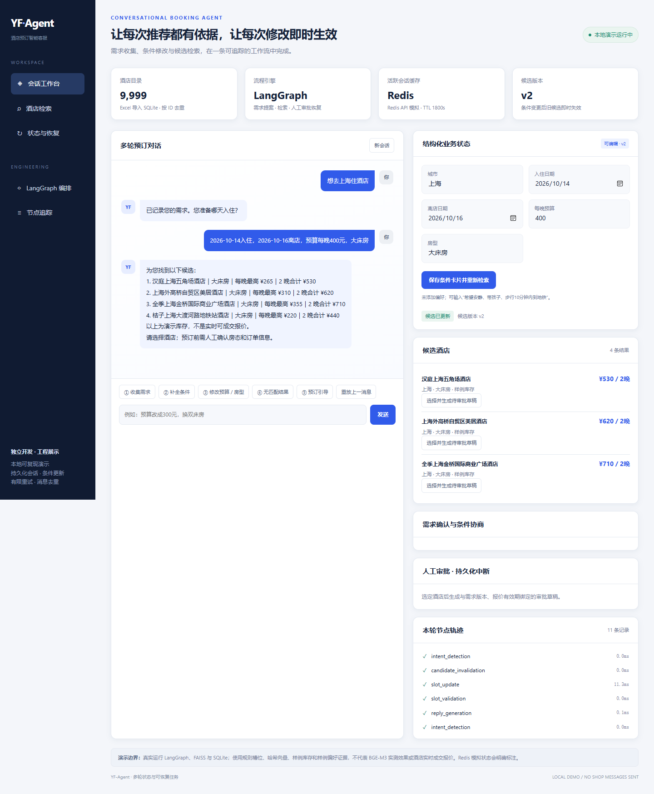

# 酒店预订智能客服 Agent

**角色：独立开发酒店预订业务场景。场景：在闲鱼店铺提供酒店预订服务。**

通过客服对话收集酒店入住需求，将城市、日期、预算等条件连接到酒店检索和查价工具，支持用户修改需求及预订引导。

## 我的工作

- **业务工具：** 将酒店查询、价格获取与客服工具调用连接起来，支持需求收集、酒店推荐和预订引导。
- **多轮会话：** 维护对话历史、业务条件和任务状态；需求变化后更新查询条件，避免回复继续依赖过期候选。
- **消息处理：** 处理连续消息、会话并发、工具超时与恢复，保留执行日志便于排查。
- **评测方法：** 使用规则断言和人工复核检查槽位缺失、需求修改及无匹配结果等场景，定位状态与工具调用问题。

## 阅读代码的入口

| 模块 | 关注内容 |
| --- | --- |
| `booking_service.py` | LangGraph 预订图、会话并发、去重与恢复 |
| `booking_slots.py` / `requirement_contracts.py` | 业务槽位、需求版本与条件修改协议 |
| `session_store.py` | Redis 活跃缓存、SQLite 持久状态与节点轨迹 |
| `hotel_repository.py` | SQLite 酒店目录、逐日房态与 FAISS 排序 |
| `constraint_negotiator.py` / `booking_approval.py` | 无匹配方案协商、人工审批与持久工作流恢复 |
| `demo_web.py` / `web/` | FastAPI 工作台、条件卡片、SSE 与执行记录 |
| `run_xianyu.py` / `utils/hotel_tools.py` | 平台消息接入、真实查价与采集 |

[查看个人项目仓库](https://github.com/spark216/YF-agent) · [运行演示](https://github.com/spark216/YF-agent/blob/main/docs/DEMO.md) · [测试说明](https://github.com/spark216/YF-agent/blob/main/docs/TESTING.md)

项目沿用开源客服基础，并开发酒店预订业务场景。早期项目开发与 2026 年 10 月整理增强的功能在仓库 README 中分别说明。

公开演示使用合成库存、哈希编码器和模拟 Redis，演示工程流程；真实模型、服务与平台接入需要相应配置。原始目录导入 9,999 家酒店，约 1 万家。60 条合成轨迹与自动测试属于工程验证，不能直接解释为模型准确率或实际成交指标。

[返回作品集首页](../README.md)
