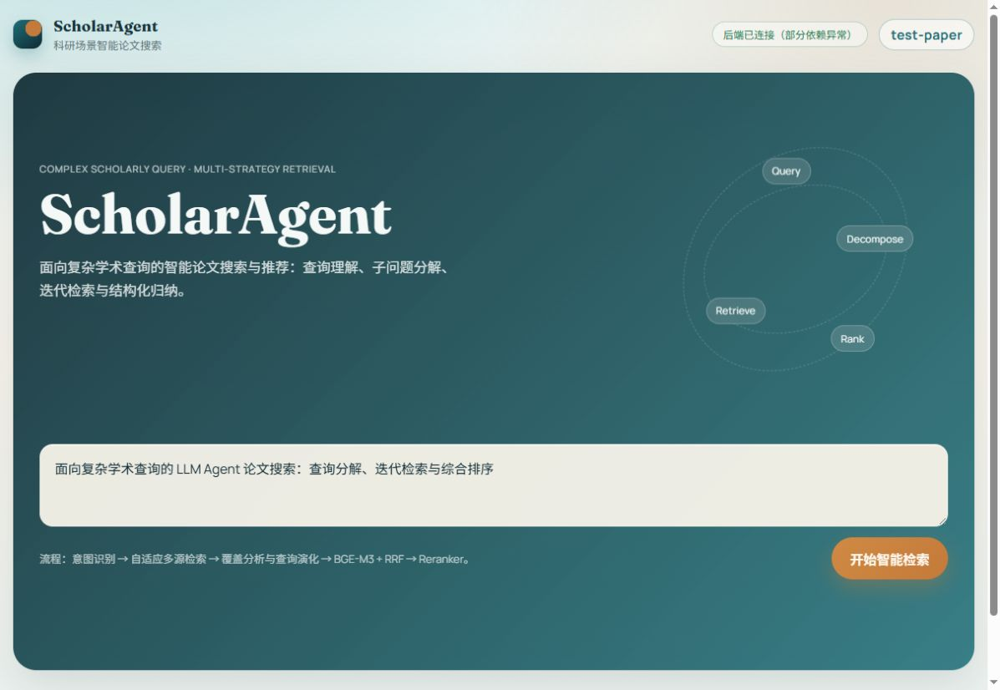
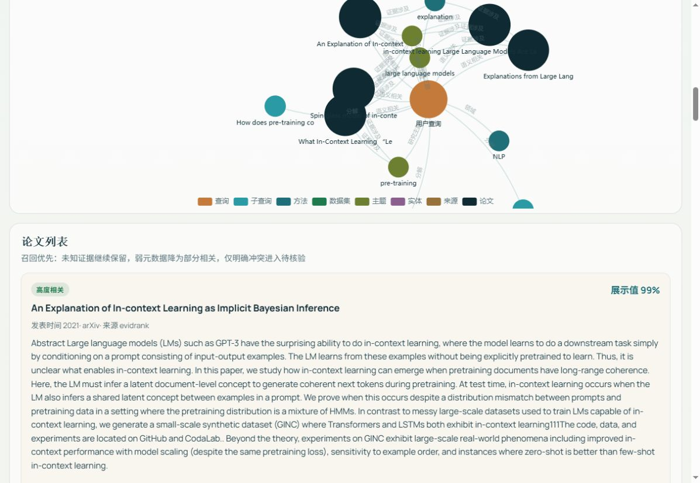
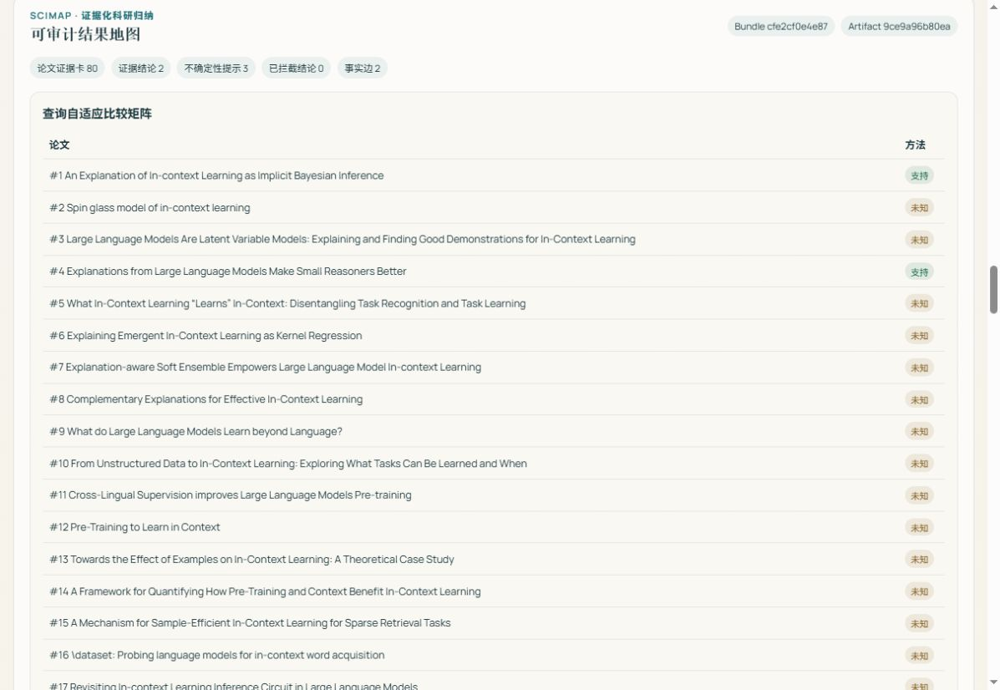

# ScholarAgent 学研智搜

**角色：核心开发；三人团队中负责 Agent 编排、检索调度与迭代控制。**

面向科研人员的论文检索系统，将自然语言研究需求转换为多源检索、结果排序和可回查的证据整理。项目通过 Vue 3 界面、FastAPI 后端及 LangGraph 检索控制器形成交互流程。

## 我的贡献

- **检索控制：** 维护候选集、未覆盖分面、检索轮次和 API 预算，通过条件路由决定继续搜索、演化查询或终止。
- **来源整合：** 调度 OpenAlex、Semantic Scholar 等来源，按论文身份去重并规范化结果，形成下游排序可使用的候选池。
- **异常与复测：** 外部服务使用独立超时、有限重试、熔断和缓存；异常时降级至本地 FTS，并保留阶段轨迹与工具响应。

## 系统检索设计

多源学术 API 与本地 FTS5 词法检索协同召回；BGE-M3 提供语义表示，FAISS 支持稠密向量检索，RRF 融合多路排名，Cross-Encoder 复核相关性。后续证据排序及研究归纳由团队模块共同完成。

系统架构覆盖团队整体实现；我的主要责任是 Agent 编排与检索控制。

## 运行演示

截图对应项目仓库记录的 2026-10-11 本地真实运行。演示使用实际学术服务和本地模型；具体运行条件、输出及已知限制见演示文档。

- [源码与运行指南](https://github.com/spark216/scholar-agent)
- [真实运行演示](https://github.com/spark216/scholar-agent/blob/main/docs/DEMO.md)
- [实验与消融报告](https://github.com/spark216/scholar-agent/blob/main/docs/ABLATION_REPORT.md)

[返回作品集首页](../README.md)
